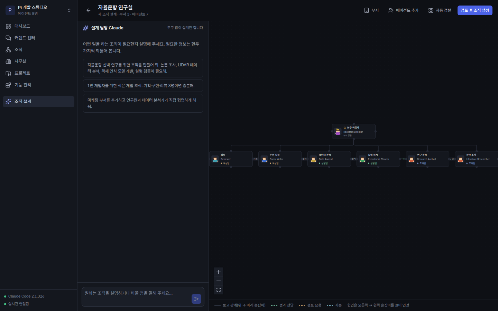
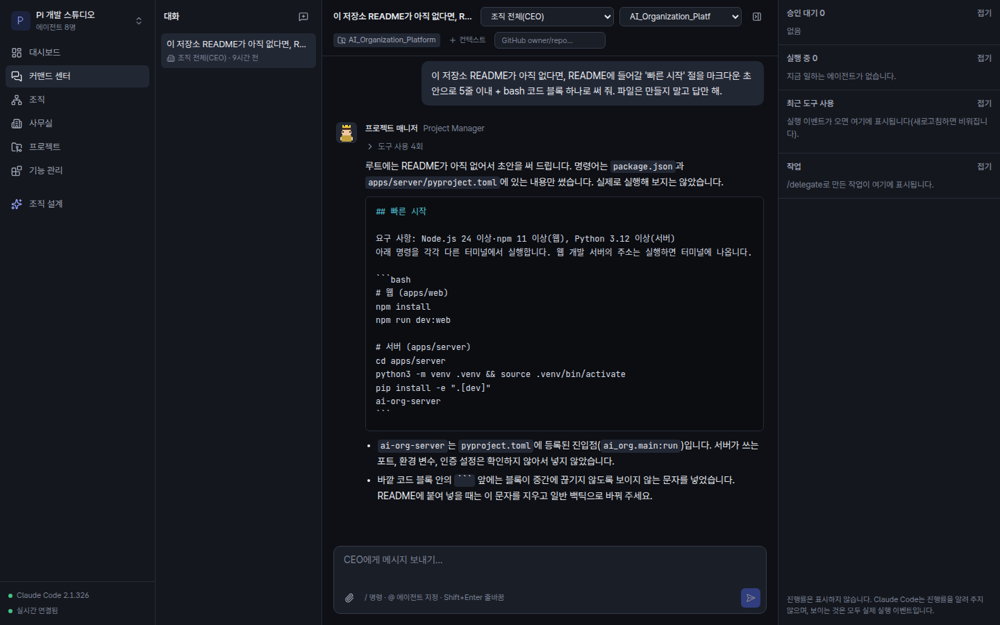
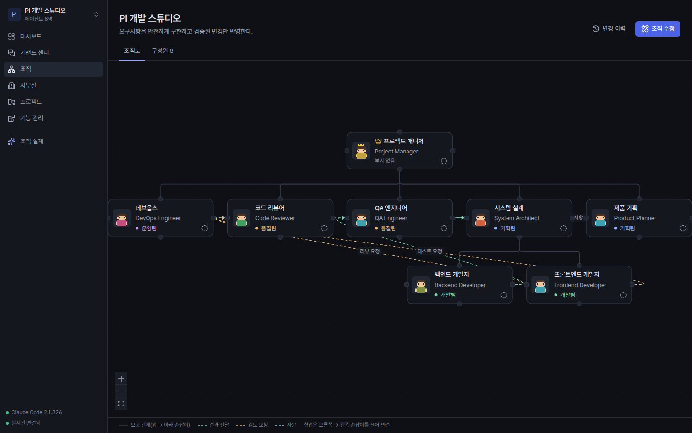
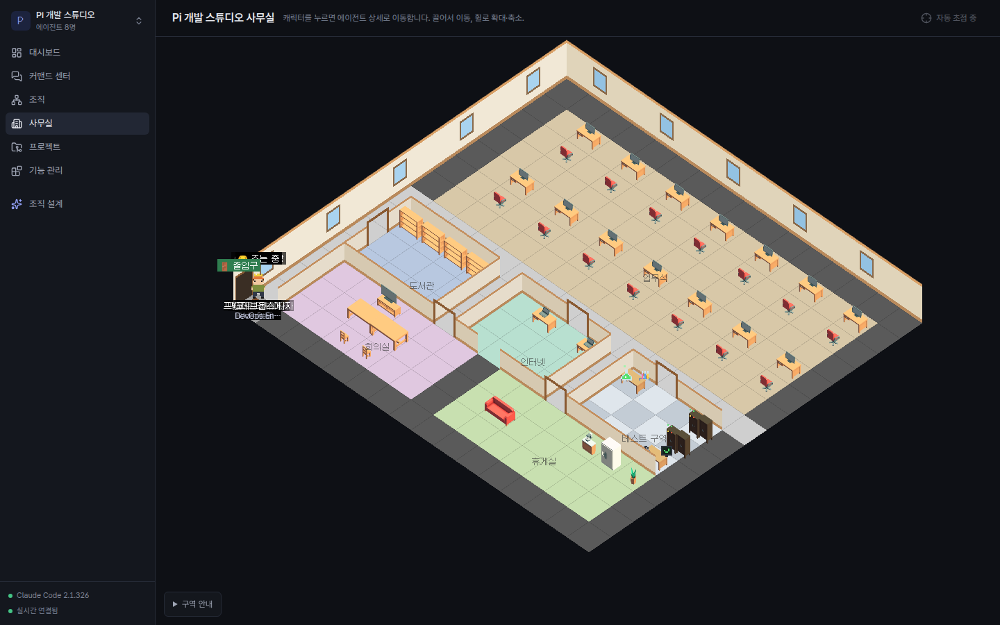

# AI Organization Platform

내 컴퓨터에서 **AI 회사**를 만들고 운영하는 로컬 퍼스트 플랫폼. 조직도를 설계하고, 에이전트에게 직책과 권한을 주고,
CEO에게 일을 맡기면 **실제 Claude Code 에이전트**가 이 컴퓨터에서 일한다. 모든 활동은 조직도와 아이소메트릭 사무실로 보인다.

> 상태: **초기 개발(0.0.x)**. 조직 설계·채팅·단일 에이전트 실행·승인은 동작한다. CEO의 자동 업무 분배(오케스트레이션),
> MCP 실행 연결, 로그인은 아직 없다. 기능별 상태는 [docs/ROADMAP.md](docs/ROADMAP.md).

| 조직 설계(대화 + 조직도) | 커맨드 센터 |
|---|---|
|  |  |
| **조직도(운영)** | **사무실** |
|  |  |

## 핵심 가치

- 누구나 템플릿이나 대화로 AI 조직을 설계한다. 템플릿은 출발점일 뿐 모든 것을 고칠 수 있다.
- 에이전트는 흉내가 아니라 **사용자의 Claude Code**로 실제 일을 한다(별도 API 키를 받지 않는다).
- 권한은 에이전트마다 좁히고, 위험한 작업은 **사람이 승인**한다. Claude Code의 권한 체계를 우회하지 않는다.
- 로컬 실행이 기본이다. 서버·클라우드 비용이 없다.

## 주요 기능

| 영역 | 지금 되는 것 |
|---|---|
| 조직 설계 | 템플릿 6종 미리보기, 설계 담당 Claude와 대화형 설계, 조직도 직접 편집, AI 권한 제안 수락, 검토 후 생성, 변경 이력·되돌리기 |
| 커맨드 센터 | CEO·팀·에이전트 대화, 실시간 스트리밍, 마크다운·코드 하이라이트, 중지·다시 생성, `@멘션`·`@All`, `/` 명령 12종, 파일 첨부, 컨텍스트 첨부, 실행 패널·승인 |
| 실행 | Claude Code(Agent SDK) 실행, 세션 이어가기, 도구 사용 이벤트, 에이전트 상태, 정책·승인 |
| 프로젝트 | 탐색 경로 등록, 프로젝트 탐색·등록, Git 상태(읽기 전용), 조직 연결 |
| 기능 관리 | Skills·MCP·Plugins 읽기 전용 탐색, 에이전트별 허용 목록 |
| 사무실 | Agent Office 아이소메트릭 렌더러, 에이전트 상태·활동에 따라 구역 이동 |

## 아키텍처 개요

```
브라우저 (React + Vite, :3000)  ── HTTP /api/v1 · WebSocket /api/v1/ws ──▶  로컬 백엔드 (FastAPI, 127.0.0.1:8000)
                                                                           ├─ 조직·설계·프로젝트·채팅 API
                                                                           ├─ RunManager ─▶ Claude Agent SDK ─▶ claude CLI (에이전트마다 프로세스)
                                                                           ├─ 권한 정책(PreToolUse 훅) · 승인 대기
                                                                           └─ SQLite (~/.ai-org/ai-org.db)
```

자세한 내용: [docs/ARCHITECTURE.md](docs/ARCHITECTURE.md)

## 기술 스택

- 웹: React 19, TypeScript 7, Vite 8, Tailwind CSS v4, Radix(shadcn 방식 컴포넌트), React Flow 13, TanStack Query, Phaser 4, lucide
- 백엔드: Python 3.12+, FastAPI, SQLAlchemy 2, SQLite, Pydantic 2, Claude Agent SDK(Python)
- 실행: 사용자가 설치한 Claude Code CLI

선택 근거는 [docs/decisions/](docs/decisions/)의 ADR.

## 디렉터리 구조

```
apps/server/            FastAPI 백엔드 (src/ai_org: api, services, runtime, templates, models, spec)
apps/web/               React 웹 (src: components, features, lib, styles)
docs/                   설계·운영 문서, ADR(docs/decisions)
scripts/dev.sh          백엔드 + 웹 동시 실행
.claude/skills/         디자인 작업용 Claude Code Skills
.github/                PR·Issue 템플릿, CI
```

## 사전 요구사항

- Linux 또는 macOS(검증: Raspberry Pi OS/Ubuntu 24.04 aarch64)
- Python 3.12+ (`python3 -m venv` 사용 가능)
- Node.js 24+ / npm 11+
- [Claude Code](https://code.claude.com/docs/) CLI 설치 및 로그인(`claude` 실행 → 로그인)

## 설치

```bash
git clone https://github.com/apg0001/AI-Organization-Platform.git
cd AI-Organization-Platform
npm install                                    # 웹 의존성
cd apps/server && python3 -m venv .venv && .venv/bin/pip install -e '.[dev]' && cd ../..
```

`claude-agent-sdk` 휠은 CLI 바이너리를 포함해 약 170MB다. 실행은 이 앱이 찾은 **사용자의 `claude`**(PATH)를 쓴다.

## 실행(개발)

```bash
./scripts/dev.sh
# 웹:  http://127.0.0.1:3000
# API: http://127.0.0.1:8000/api/docs
```

따로 실행하려면 `apps/server/.venv/bin/ai-org-server`와 `npm run dev:web`.

## 환경 변수

[.env.example](.env.example)에 모든 변수와 기본값이 있다. 주요 값: `AI_ORG_HOME`(데이터, 기본 `~/.ai-org`),
`AI_ORG_MAX_RUNS`(동시 실행 수, 기본 2), `AI_ORG_APPROVAL_TIMEOUT`(승인 대기, 기본 900초).

## Claude Code 연결

이 앱은 Claude Code 자격증명을 읽거나 저장하지 않는다. 사용자가 CLI에 로그인해 두면 에이전트 실행이 그 로그인을 쓴다.
사이드바 아래에 감지된 버전이 표시된다. `ANTHROPIC_API_KEY`가 환경에 있으면 CLI가 API 키 과금을 우선하므로 주의한다.
자세한 동작·제한: [docs/RUNTIME_INTEGRATION.md](docs/RUNTIME_INTEGRATION.md)

## 사용 방법

1. **조직 만들기** — 사이드바 `조직 설계` → 템플릿을 미리 보고 시작하거나 `AI와 함께 만들기`로 목적을 설명한다.
   조직도에서 직접 고치고, `검토 후 조직 생성`에서 확인한 구성만 만들어진다.
2. **프로젝트 등록**(선택) — `프로젝트` → 탐색 경로 추가 → 찾은 프로젝트 등록. 대화에 연결하면 에이전트가 그 폴더에서 일한다.
3. **일 맡기기** — `커맨드 센터`에서 CEO에게 말하거나, `@이름`으로 특정 에이전트에게, `/delegate @이름 업무`로 작업을 위임한다.
4. **승인** — 셸 명령·파일 수정 등 승인이 필요한 도구는 채팅 위와 실행 패널에 승인 요청이 뜬다.
5. **지켜보기** — `사무실`에서 캐릭터가 활동에 따라 서재·회의실·테스트 구역으로 이동한다.

## 테스트

```bash
cd apps/server && .venv/bin/ruff check src tests && .venv/bin/ruff format --check src tests && .venv/bin/mypy && .venv/bin/pytest
cd ../.. && npm run typecheck && npm test && npm run build
```

[docs/TESTING.md](docs/TESTING.md)

## 문제 해결

[docs/TROUBLESHOOTING.md](docs/TROUBLESHOOTING.md) — Claude Code를 찾지 못함, 포트 충돌, 응답이 느림(라즈베리 파이), 승인이 오지 않음 등.

## 문서

제품 비전 [PRODUCT_VISION](docs/PRODUCT_VISION.md) · 요구사항 [REQUIREMENTS](docs/REQUIREMENTS.md) · 로드맵 [ROADMAP](docs/ROADMAP.md) ·
아키텍처 [ARCHITECTURE](docs/ARCHITECTURE.md) · DB [DATABASE](docs/DATABASE.md) · API [API](docs/API.md) ·
런타임 [RUNTIME_INTEGRATION](docs/RUNTIME_INTEGRATION.md) · 오케스트레이션 [AGENT_ORCHESTRATION](docs/AGENT_ORCHESTRATION.md) ·
조직 설계 [ORGANIZATION_BUILDER](docs/ORGANIZATION_BUILDER.md) · 템플릿 [TEMPLATE_SYSTEM](docs/TEMPLATE_SYSTEM.md) ·
채팅 [CHAT_SYSTEM](docs/CHAT_SYSTEM.md) · 기능 관리 [CAPABILITY_MANAGER](docs/CAPABILITY_MANAGER.md) ·
프로젝트 [PROJECT_MANAGER](docs/PROJECT_MANAGER.md) · 보안 [SECURITY](docs/SECURITY.md) ·
디자인 [DESIGN_SYSTEM](docs/DESIGN_SYSTEM.md) · [UI_UX_GUIDELINES](docs/UI_UX_GUIDELINES.md) · [COMPONENT_GUIDELINES](docs/COMPONENT_GUIDELINES.md) ·
재사용 분석 [REUSE_ANALYSIS](docs/REUSE_ANALYSIS.md) · 배포 [DEPLOYMENT](docs/DEPLOYMENT.md) · Git [GIT_CONVENTION](docs/GIT_CONVENTION.md) · 기여 [CONTRIBUTING](CONTRIBUTING.md)

## 라이선스

**미정(TBD)** — 소유자가 배포 방향을 정한 뒤 LICENSE를 추가한다. 포함된 제3자 코드·에셋의 라이선스는
[THIRD_PARTY_NOTICES.md](THIRD_PARTY_NOTICES.md).
